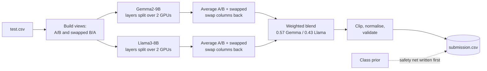
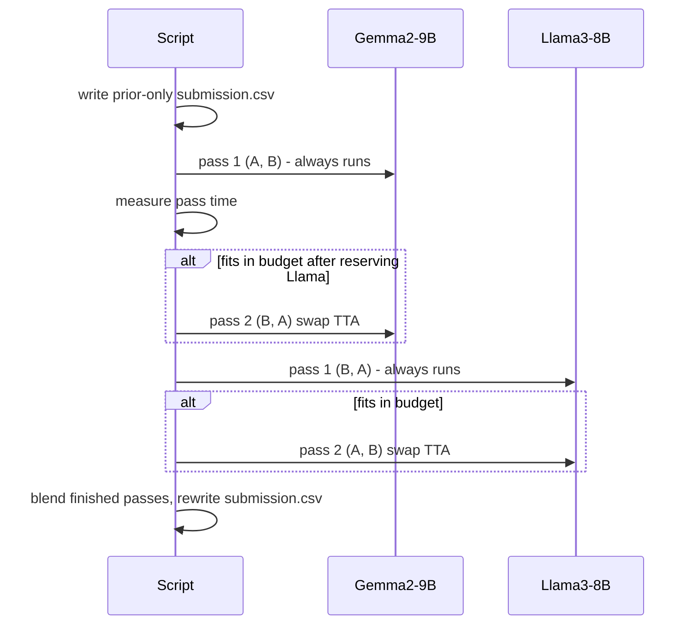

<div align="center">

# LMSYS Preference Ensemble

**Predicting human preference between two LLM answers with a time-aware Gemma2-9B + Llama3-8B ensemble.**

[](https://www.python.org/)
[](https://pytorch.org/)
[](https://www.kaggle.com/competitions/llm-classification-finetuning)
[](#results)
[](LICENSE)

</div>

---

## Overview

In the [LLM Classification Finetuning](https://www.kaggle.com/competitions/llm-classification-finetuning)
competition, each row holds a user prompt and two chatbot responses, and the goal is to predict the
probability that a human prefers response A, response B, or calls it a tie. The metric is **multi-class log loss**.

This repository contains a single-file inference pipeline that:

- runs two fine-tuned classifiers (**Gemma2-9B** and **Llama3-8B**, checkpoints by [tascj0](https://www.kaggle.com/tascj0)) split across two T4 GPUs,
- applies **swap test-time augmentation** (each pair is scored as A/B and as B/A, then averaged),
- blends the models with a weighted arithmetic mean,
- **always writes a valid `submission.csv`**, even if a model or pass fails,
- fits itself into the 9-hour Kaggle limit by measuring pass time and skipping optional passes.

## Architecture



### Time-aware scheduling



## Repository structure

```text
.
├── src/
│   └── lmsys_boosted_ensemble.py   # the full inference pipeline (single file)
├── kernels/                        # Kaggle notebook wrappers + metadata
│   ├── baseline/                   # runs the pipeline as-is
│   ├── validation-probe/           # scores 3,000 labelled train rows, saves probabilities
│   ├── variant-geo/                # experiment: geometric-mean pooling
│   └── variant-temp11/             # experiment: temperature 1.1 on final probabilities
├── scripts/
│   └── analyze_validation.py       # log loss of the probe's saved probabilities
├── LICENSE
└── README.md
```

## Requirements

| Item | Value |
|---|---|
| Platform | Kaggle notebook, Python 3.10 environment |
| Accelerator | GPU T4 x2 |
| Internet | Off |
| Competition data | `llm-classification-finetuning` |
| Datasets to attach | `tascj0/lmsys-packages`, `tascj0/lmsys-modules-0805`, `tascj0/lmsys-checkpoints-0-0805` (Gemma2-9B), `tascj0/lmsys-checkpoints-3-0805` (Llama3-8B) |

The script needs Python 3.10 because the bundled `triton` and `xformers` wheels are `cp310` builds.

## Usage

1. Upload `src/lmsys_boosted_ensemble.py` as a private Kaggle dataset.
2. Create a notebook with the datasets above, set the accelerator to **GPU T4 x2**, and run:

```python
import glob
exec(open(glob.glob("/kaggle/input/**/lmsys_boosted_ensemble.py", recursive=True)[0]).read())
```

3. Submit the notebook to the competition.

Or push a ready-made wrapper with the Kaggle CLI (replace `YOUR_KAGGLE_USERNAME` in the metadata first):

```bash
kaggle kernels push -p kernels/baseline
kaggle competitions submit llm-classification-finetuning \
    -k YOUR_KAGGLE_USERNAME/lmsys-baseline -f submission.csv -v 1 -m "baseline"
```

### Configuration

Settings sit at the top of the script:

| Setting | Default | Meaning |
|---|---|---|
| `BUDGET_S` | `8 * 3600` | stop starting optional passes after this many seconds |
| `WEIGHTS` | `gemma 0.57, llama 0.43` | blend weights |
| `POOL` | `"arith"` | `"arith"` weighted mean or `"geo"` weighted geometric mean |
| `VALIDATE_N` | `0` | score this many labelled train rows (optimistic, see below) |
| `LENGTH_PRIOR` | `0.0` | optional nudge toward the longer response |
| `SMART_TRUNCATION` | `False` | head+tail truncation instead of the stock processor |

### Outputs

`submission.csv`, `prob_<model>_<direction>.npy` (raw probabilities per pass), `run_summary.json`,
and `charts/dashboard.png` (nine diagnostic panels).

## Submission safety

- A prior-only `submission.csv` is written before any GPU work.
- Every model load and pass is wrapped; a failure is logged and the run continues.
- The file is written atomically and checked against `sample_submission.csv` (ids, columns, no NaN, rows sum to 1).
- If no pass finishes, the script raises instead of silently submitting priors.

## Results

| Submission | Public log loss |
|---|---|
| Gemma2-9B + Llama3-8B, time-aware swap-TTA | **0.83040** |
| `variant-temp11` (temperature 1.1) | pending |
| `variant-geo` (geometric pooling) | pending |

Notes from the experiments:

- On the full test set, one Gemma pass takes roughly 3.5 h and one Llama pass roughly 2.5 h, so all four passes do not fit in the 9 h limit. The scheduler skips the optional passes that do not fit.
- On 3,000 train rows the models score 0.69 (Gemma) and 0.59 (Llama) log loss. These checkpoints were trained on `train.csv`, so this is optimistic and **not** suitable for tuning blend weights.

## Credits

Model checkpoints, modeling code and the original pipeline come from
[tascj0](https://www.kaggle.com/tascj0)'s Kaggle datasets. This repository adds the swap-TTA scheduling,
submission-safety layer, diagnostics and experiments.

## License

[MIT](LICENSE)
